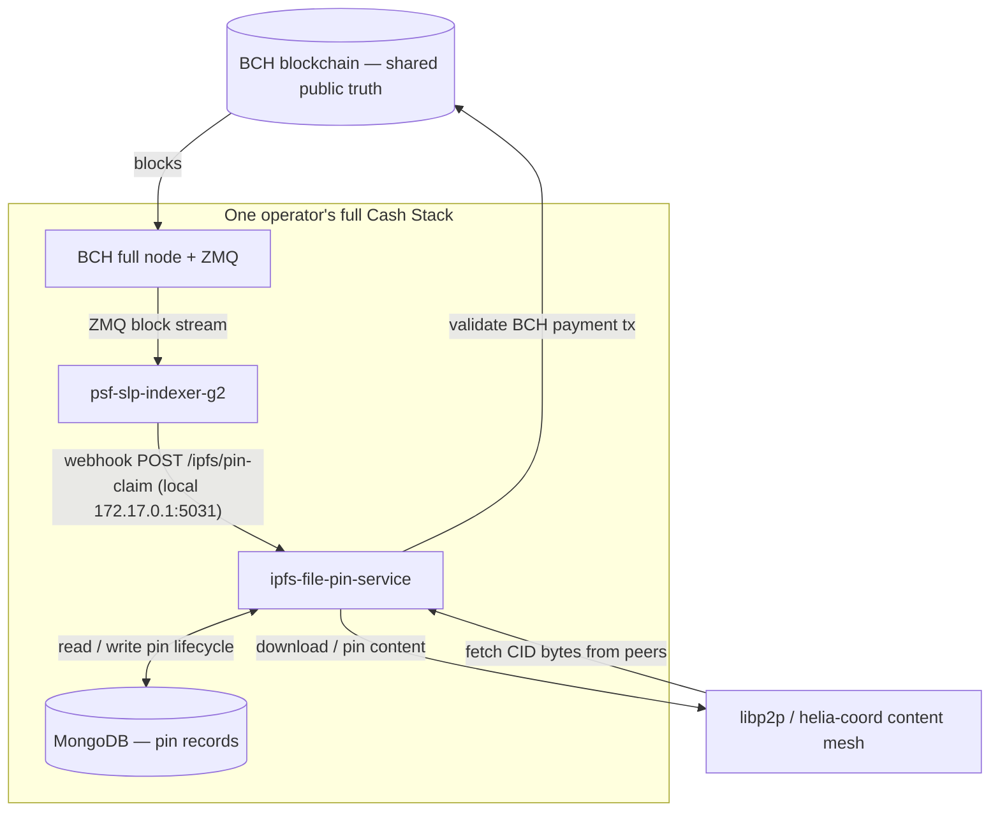
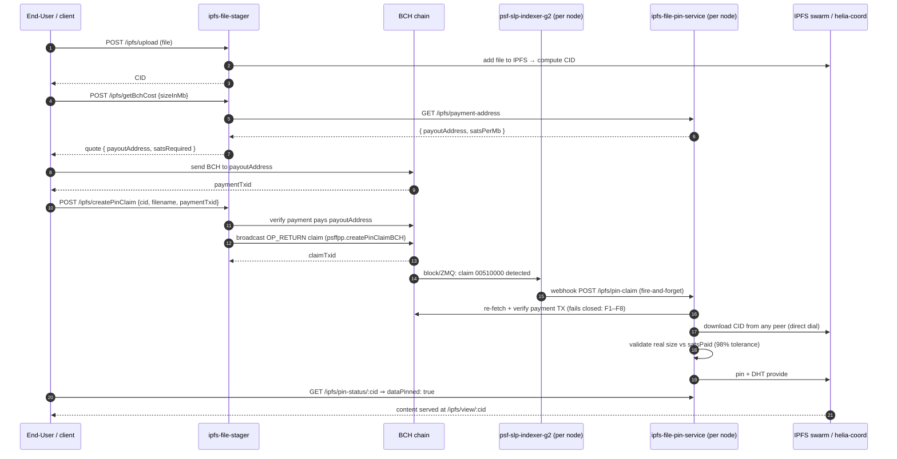
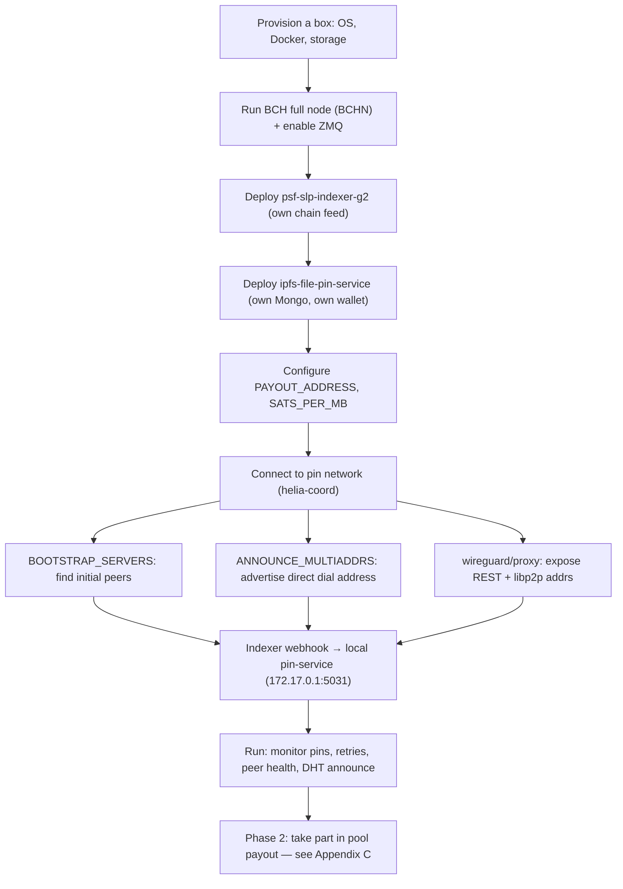
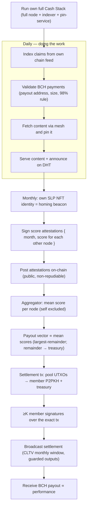

# File Pinning Protocol

## Permissionless Software Foundation Specification 010 (PS010)

### Specification version: 2.0.0

### Supersedes: [PS010 v1.0.0 — File Pinning Protocol, PSF-token proof-of-burn](https://github.com/Permissionless-Software-Foundation/specifications/blob/3ec369935b2d11bd551ba542c104a84bb6641e23/ps010-file-pinning-protocol.md)

Archive note: the v1.0.0 link above is a permanent link into this repository's
history — the old text stays browsable even after this revision merges. PS010
v1.0.0 remains the governing answer for pins created under it (section 8.1);
this revision does not re-validate them.

### Date originally published: April 6, 2024

### Date last updated: 2026-11-27

## Authors

Chris Troutner (v1.0.0); revision 2.0.0 drafted under Sam (Cash Stack).

## Normative language

MUST, MUST NOT, SHOULD, MAY are used in the RFC 2119 sense. Where this document
is silent, the frozen byte layout in `psffpp-payments/docs/infra-changes.md` is
authoritative — that document freezes wire bytes; this one states protocol rules.

---

## 1. Introduction

This specification describes a protocol for storing (pinning) files on the
[IPFS](https://ipfs.io) network. It is the Permissionless Software Foundation
File Pinning Protocol (PSFFPP).

This revision changes the payment layer only, and it is a **clean break**. In
v1.0.0 a pin was paid for with PSF-token proof-of-burn. In v2.0.0 a pin is paid
for with a targeted fee of $0.01/MB paid in BCH — in Phase 1 to a single
operator-configured payout address, in Phase 2 to a pool contract whose address
and per-epoch rate come from a controller-published, append-only registry.
PS010 v2.0.0 accepts **BCH payments only**: there is no legacy acceptance mode,
no compatibility flag, and no dual validation path. The proof-of-burn payment
mechanism is removed, not frozen.

The protocol remains anonymous, permissionless, and censorship-resistant: no
account, no identity, no token purchase, and no permission is required. A payer
needs only a BCH wallet. Pinning nodes remain free to accept or refuse any claim,
exactly as BCH nodes independently validate transactions.

This specification builds on the PS008 specification for Claims. The Pin Claim
OP_RETURN core — `0x00510000 | field2(32B) | cid | filename` — is unchanged from
v1.0.0. Field 2 now carries exactly one thing: the txid of the BCH payment that
bought the pin. Only the meaning of field 2 and the validation of payment change.

### System overview

Fig. 1 — one network node is an operator's own full Cash Stack; the only
cross-operator surfaces are the libp2p content mesh and the public BCH chain.



Within a node, the indexer is a **messenger only** (it detects claims and
webhooks the local pin-service); it never validates payment. The pin-service is
the only component that resolves addresses and validates sats (section 7).

### Scope

In scope: BCH-only payment for pinning; the Phase-1 single-payout-address
deployment; Pin Claim semantics; single-mode validation requirements; cutover
from v1.0.0. The pool registry announcement format (`PSP1`) and its
auth/chain/epoch rules remain in scope as the **Phase-2** design; Phase 1 is
registry-free.

Out of scope: pins created under v1.0.0 and software released before v2.0.0
(no compatibility is provided for either); the CashScript pool/share contract
internals (see `psffpp-payments/docs/why-cashscript.md`), pool payout schedule
and operator set, wallet software, IPFS pinning mechanics, and a live USD/BCH
oracle at validation time. All CashScript/registry implementation work is
deferred to Phase 2.

### Deployment phases

v2.0.0 is deployed in two phases. The claim format, fee rules (`satsPerMb` plus
the 100 KB floor), and the 98% tolerance are identical in both; the difference is
where the sats go and how the payable address is resolved.

- **Phase 1 (this deployment).** File-hosting payments go directly to a single
  operator-configured BCH payout address, with no contracts, no registry, no
  epochs and no pool rotation. The Phase-1 default payout address is the
  `pinning` wallet —
  `bitcoincash:qrhmpdplkmr2lwf8ekusaxzqntx7c9hp9utzcvkjcr` (SLIP-0044 coin type
  145), under Sam's control. `satsPerMb` is operator-configured (env) and served
  by `GET /ipfs/payment-address` (sections 3, 6, 7).
- **Phase 2 (future).** Once the payment loop is verified end-to-end, the frozen
  `psffpp-payments/docs/infra-changes.md` design applies: the `PSP1` registry,
  pool rotation, and the CashScript pool/share payout contracts that enable
  revenue divvying among operators (sections 4 and 7.2).

Phase 1 payloads and claims stay valid in Phase 2: the first Phase-2 registry
epoch can simply list the Phase-1 payout address (section 8.3).

### Relationship to the PSF-token phase-out

This document is the first slice of the PSF-token phase-out. It
is deliberately the *protocol* slice: it defines what a valid BCH-paid pin is,
so that M2 (codec/announcer), M3 (pin-service BCH-only validation), M4 (clients
and indexer comments), and M5 (deletion of the burn path) can be built against a
fixed contract rather than inferred from code.

### What changed from PS010 v1.0.0

- "can be paid through the use of SLP tokens" becomes "$0.01/MB targeted fee
  paid in BCH to a pool contract" (Phase 2), or to a single operator-configured
  payout address (Phase 1).
- The "token price fluctuates relative to USD" paragraph is replaced by a BCH
  sat amount fixed for the life of a claim: per registry epoch in Phase 2, per
  deployment in Phase 1 (section 3).
- Proof-of-burn is deleted as a payment mechanism. It is not retained as a
  legacy annex, and no v1.0.0 claim is re-validated under v2.0.0 (section 8).
- Dual-mode validation (`ACCEPT_LEGACY_PSF_POB`, `_getTokenQtyDiff`, PS009
  write-price lookups) is removed. Validation is single-mode, BCH only
  (section 7).
- The "$0.01 minimum cost" rule is a locked 100 KB floor (section 3).
- Unconfirmed claims are accepted with no special handling. Epoch resolution is by
  claim height everywhere, and an unconfirmed claim is assigned the height
  `currentTipHeight + 1` (section 7.2).
- Payment-txid reuse keeps existing `handleRenewal` / TXID-keyed semantics, and
  the version string stays "PS010 v2.0.0".
- Every decision above was locked by Chris on 2026-11-23; section 9 records them
  as normative rather than as open questions.
- `psffpp` npm burn API references are replaced by "send BCH, then build the
  claim"; the indexer's role and webhook path are described as they exist today.
- Deployment is two-phase (section 1). Phase 1 pays a single operator-configured
  BCH payout address (default: the `pinning` wallet) with an
  operator-configured `satsPerMb` and no registry, epochs or pool contracts; the
  `PSP1` registry and CashScript pool/share payout (revenue divvy) are deferred
  to Phase 2 (decision 9e).

---

## 2. Terms

Pool
: A P2SH32 CashScript `PoolContract` instance. Users pay pinning fees into it.
  One pool instance per payout epoch; rotation is expected, not exceptional.
  **Phase-2 machinery**: in Phase 1 there are no pools — see **Payout address
  (Phase 1)**.

Pool Contract
: The CashScript contract that defines a pool (deposit address, consolidation,
  blockheight-gated split, k-of-m migration). Address rotates per epoch.
  **Phase-2 machinery.**

Pool address
: The `bitcoincash:` cashaddr of a deployed Pool Contract, in P2SH32 form.
  **Phase-2 machinery.**

Payout address (Phase 1)
: The single operator-configured BCH cashaddr that Phase-1 payments are sent to.
  The Phase-1 default is the `pinning` wallet,
  `bitcoincash:qrhmpdplkmr2lwf8ekusaxzqntx7c9hp9utzcvkjcr` (SLIP-0044 coin type
  145). It is a plain wallet address, not a contract: there is exactly one, it is
  valid for all claims at every height, and operators MAY rotate it by
  configuration (a rotation is an ops action, not a protocol event). If it is
  unset, validation fails closed (F1).

Controller address (interim bootstrap)
: The **interim** registry authority: a single BCH cashaddr configured in
  pin-service as `POOL_REGISTRY_CONTROLLER`, used only to bootstrap the registry
  before the council layer is deployed. Only transactions whose first input
  spends from this address may publish a registry epoch while it is in force.
  It is *temporary*, exactly like the Phase-1 `satsPerMb` environment variable
  (section 3), and MUST be treated as such — never as the governance model.
  **Phase-2 machinery (interim only).**

Registry council (long-term)
: The long-term registry authority: a **P2SH multisig address** controlled by a
  **group of stakeholders** (e.g. the PSF Minting Council, or this network's
  node-operator council). Registry epochs — pool address and `satsPerMb` — are
  authorized by the [PS009 — Multisig Approval](ps009-multisig-approval.md)
  workflow: n-of-m members approve each update, so **no single entity** can set
  prices or redirect the pool. **Phase-2 machinery (long-term).**

Registry epoch
: The interval `[H_i, H_{i+1})` during which announcement `i` — and therefore
  pool address `A_i` and rate `satsPerMb_i` — is the valid pool for new claims.
  The latest epoch extends to `+∞`. **Phase-2 machinery**: Phase 1 has no
  epochs (section 7.2).

Announcement
: A transaction containing a `PSP1` OP_RETURN in vout[0] that publishes one
  epoch. Append-only; linked to its predecessor by `prevRegistryTxid`.
  **Phase-2 machinery.**

Pin Claim
: A transaction with a `0x00510000` OP_RETURN in vout[0] that names the file to
  pin and the transaction that paid for it.

Payment TX
: A BCH transaction that pays at least the required sats into the validating
  address at the presenting claim's height — in Phase 1 the configured payout
  address; in Phase 2 the pool address valid at that height (an unconfirmed
  claim counts as `currentTipHeight + 1`, section 7.2). It is the transaction
  named by the Pin Claim's field 2.

Payment txid
: The 32-byte txid carried in a Pin Claim's field 2. In v2.0.0 it MUST be a BCH
  payment txid; no other referent is permitted.

`satsPerMb`
: Integer satoshis required per megabyte of pinned data per year, fixed when the
  rate is set — per registry announcement in Phase 2, per deployment
  configuration in Phase 1. Never recomputed at validation.

Clean break
: v2.0.0's stance on v1.0.0: only BCH payments are accepted. There is no
  legacy proof-of-burn mode, no compatibility flag, and no dual validation path.
  Pins created under v1.0.0 and software released before v2.0.0 are out of scope.

Pinning wallet / book-keeping nexus
: Operational controller wallet (`pinning`, SLIP-0044 coin type 145). In Phase 1
  it is also the payable address: users pay this wallet directly (see **Payout
  address (Phase 1)**). In Phase 2 it is the controller and book-keeping nexus
  for the pool, and users pay the Pool Contract address instead — the payable
  address then always comes from the Pool Contract deploy record.

---

## 3. Fee schedule

### Locked target

The targeted price of pinning is approximately **$0.01 USD per megabyte per
year**. The target is a pricing *intent*, not a validated value. Claims are
never validated against USD.

### Denomination

Each registry announcement bakes an integer `satsPerMb` (uint64, satoshis per
megabyte per year) computed at announcement time. Claims in epoch `i` are
validated against `satsPerMb_i` only (Phase 2; section 4).

**Phase 1 (this deployment):** `satsPerMb` is an operator-configured
**environment variable** — a temporary implementation detail, not a protocol
value. It is served by `GET /ipfs/payment-address`, and validation uses that
configured value for every claim at every height. There is no announcement and
no epoch in Phase 1.

**Phase 2 (future):** the environment variable is superseded by a **dynamic,
on-chain rate update**. New `satsPerMb` values are authorized by the
[PS009 — Multisig Approval](ps009-multisig-approval.md) workflow (a multisig
council, as the PSF Minting Council has historically used) and distributed
through the registry epochs of section 4. This is a *reuse* of PS009's
approval mechanism; it does **not** revive the removed legacy PS009 token
write-price lookup (section 8.2). The rate a claim is validated against
remains fixed and recorded per epoch, and is never recomputed from USD or from
a live oracle ("Consequences" below).

The rate semantics below (integer sats/MB/year, fixed for the lifetime of the
claim, never recomputed from USD) hold in both phases.

Consequences, all normative:

- No live USD/BCH oracle is consulted at claim validation or at registry sync.
- Historical claims remain checkable forever, because the rate used is fixed and
  recorded — on chain in the announcement active at the claim's height in Phase
  2, in the deployment configuration in Phase 1.
- A short-term BCH price move does not retroactively change the cost of a claim
  that was already made.
- The next epoch's rate absorbs price drift. Re-announcing more often is a
  policy tool, not a protocol change.

### `computeSatsPerMb` (ops helper, not used at validation)

    satsPerMb = ceil( usdPerMb / usdPerBch * 1e8 )

Inputs: `usdPerMb` (default `0.01`), `usdPerBch` (spot at announcement time).
Rounding is **up** (ceil), so the fee never drifts below the USD target.
Example (illustrative, not a fixture): `usdPerBch = 500.00` →
`0.01 / 500 * 1e8 = 2000 sats/MB/yr`.

This lives in `psffpp-payments/scripts/compute-sats-per-mb.mjs` and is an
operator convenience only. Implementations MUST NOT call it during validation.

### `requiredSats`

    requiredSats({ fileSizeBytes, satsPerMb }) =
        max( ceil( fileSizeBytes / 1e6 * satsPerMb ),
             ceil( 0.1 * satsPerMb ) )

Defined once, in the shared `psffpp-payments` pool-registry library, and
imported by both the announcer and the pin-service. Reimplementing it in a
second place is a defect, because announcer and validator would be free to
diverge. The second term is the 100 KB floor; see the next subsection.

### Minimum charge (100 KB, locked 2026-11-23)

Every claim pays for at least 100 KB, whatever the actual file size:

- Files of 100 KB or more are metered: `ceil(bytes/1e6 * satsPerMb)`.
- Files smaller than 100 KB pay the floor: `ceil(0.1 * satsPerMb)`.

The floor is a pricing rule, not a rounding allowance, so it is applied to the
required amount *before* the 98% tolerance of section 7. It also keeps client and
validator behaviour identical — there is no "clients charge a floor, validator
does not" asymmetry to carry forward.

`requiredSats()` MUST include the floor, and it is the only place the floor is
defined. Clients MUST NOT compute a floor of their own, and pin-service MUST NOT
re-derive one from `fileSizeBytes`.

---

## 4. Pool Registry (PSP1)

**Phase-2 mechanism.** This registry is the Phase-2 mechanism. Phase 1 deploys
without it: a single operator-configured payout address answers every claim
(sections 6 and 7), and no `PSP1` transaction is required to accept a payment.
The announcement layout, chain rule and epoch interval below are retained
verbatim. **The auth rule has two tiers** (section 4.2): an *interim*
single-controller bootstrap and the *long-term* P2SH multisig council — the
single-controller form exists only to get the registry running and is not the
governance model.

Registry announcements are append-only, council-approved, chain-linked
OP_RETURNs. Detection mirrors Pin Claim detection: match OP_RETURN + 4-byte
lokad.

### 4.1 Announcement layout (frozen — copied verbatim)

Lokad ASCII **`PSP1`** (PSFFPP Pool registry v1). Match existing Pin Claim
style: OP_RETURN + 4-byte push of lokad.

**scriptPubKey ASM (vout[0]):**

```text
OP_RETURN
OP_PUSHDATA 50535031          # "PSP1"
OP_PUSHDATA 01                # version = 1 (1 byte)
OP_PUSHDATA <poolCashAddrUtf8>
OP_PUSHDATA <validFromHeightLE8>
OP_PUSHDATA <satsPerMbLE8>
OP_PUSHDATA <prevRegistryTxidBin32>
```

**Field rules (do not reinterpret):**

| Field | Bytes | Encoding | Notes |
|-------|-------|----------|-------|
| lokad | 4 | `PSP1` = `50 53 50 31` | Detect: OP_RETURN hex contains `6a0450535031` (same pattern as pin claim `6a0400510000`) |
| version | 1 | `0x01` | Reject unknown versions |
| poolCashAddr | variable | UTF-8 cashaddr **with** `bitcoincash:` prefix, P2SH32 pool deposit address from deploy record | No token-aware address |
| validFromHeight | 8 | **uint64 little-endian** block height | Inclusive; use 8 bytes even if height fits in 4 |
| satsPerMb | 8 | **uint64 little-endian** satoshis per megabyte | Required rate for claims while epoch active |
| prevRegistryTxid | 32 | raw txid bytes in **Bitcoin internal byte order** (same as typically displayed hex reversed vs explorer — implementers: encode/decode with tests against a known fixture hex) | Genesis: 32 zero bytes |

**Detection code path:** same approach as `isPinClaim` in `psf-slp-indexer-g2`
(`src/adapters/transaction.js`): read `vout[0].scriptPubKey.hex`, check
prefix/includes `6a0450535031`, then `Script.toASM` + split pushes.

### 4.2 Auth rule

Two tiers, in two phases of the same Phase-2 mechanism:

- **Interim (short-term):** accept a registry TX only if the **first vin's
  prevout address** equals the configured `POOL_REGISTRY_CONTROLLER`
  (normalized cashaddr), and do not accept "controller somewhere later in vin
  list". This single-address rule is a **temporary bootstrap** — its only
  purpose is to run the registry until the council layer is deployed. It MUST
  NOT be presented as, or relied on as, the governance model.
- **Long-term (normative):** registry epochs are authorized by the **P2SH
  multisig council** (section 2) via the [PS009 — Multisig Approval]
  (ps009-multisig-approval.md) workflow: the first vin's prevout is the
  council's known P2SH address, and the accompanying n-of-m approval
  transaction is verified per PS009. **No single address or entity may set the
  price or redirect the pool.**

Normative detail for both variants: comparisons are on normalized cashaddr /
P2SH locking payloads, never on the raw script of a later input, and never on
any output.

### 4.3 Chain rule (frozen)

`prevRegistryTxid` must equal the previous accepted announcement's txid (or 32
zero bytes if DB empty / genesis). Reject if tip already has a different child
(no forks).

### 4.4 Epoch interval (frozen)

For announcement `i` with height `H_i`, address `A_i` is valid for claims with
`claimTx.height` in `[H_i, H_{i+1})`. Latest epoch: `[H_latest, +∞)`.

Epoch resolution is therefore a function of claim height only — never of wall
clock time, and never of the current tip.

### 4.5 Config-seed bootstrap (frozen, ops-only)

If Mongo is empty, pin-service may insert one synthetic genesis epoch from env
(`POOL_REGISTRY_SEED_*`) with `registryTxid = "seed"` and
`prevRegistryTxid = 00…00`. Prefer **on-chain-only** for production; the seed is
an ops bootstrap so `GET /ipfs/payment-address` can answer before the first
announcement. On first successful on-chain sync, treat the on-chain tip as
authoritative for subsequent validation.

A seed epoch is not a substitute for an announcement. It MUST NOT be used to
validate historical claims once any on-chain epoch exists, and any pin validated
against a seed epoch MUST be re-checkable when the chain catches up.

### 4.6 Shared codec (frozen)

Location: `psffpp-payments/lib/pool-registry/` (or `src/pool-registry/`):

- `encodeAnnouncement({ poolCashAddr, validFromHeight, satsPerMb, prevRegistryTxid }) → hex script / outputs`
- `decodeAnnouncement(opReturnHexOrAsm) → fields | null`
- `requiredSats({ fileSizeBytes, satsPerMb }) → max(ceil(fileSizeBytes / 1e6 * satsPerMb), ceil(0.1 * satsPerMb))`
  (the 100 KB floor is part of the shared definition — section 3)
- Unit tests with **fixture vectors** in `psffpp-payments/test/fixtures/registry-opreturn.json`

Pin-service and announce CLI **must** import this lib (path dependency or
published workspace package) — do not reimplement decode in pin-service.

---

## 5. Pin Claim

The Pin Claim wire format is unchanged from v1.0.0. Only the semantics of
field 2 change.

### 5.1 Layout

An OP_RETURN in vout[0], four parts:

1. `0x00510000` — lokad (script prefix `6a04 00510000`).
2. field 2, 32 bytes — the BCH payment txid, raw bytes (internal byte order).
3. CID — IPFS Content ID of the file, UTF-8.
4. Filename — original filename with extension, UTF-8.

### 5.2 Normative semantics of field 2

Field 2 is the **32-byte txid of the BCH Payment TX** that paid for the pin — the
transaction that sent the required sats to the validating address: in Phase 1 the
configured payout address, in Phase 2 the pool address valid at that claim's
height (section 7.2). No other referent is valid: there is no legacy
alternative and no proof-of-burn form.

The indexer keeps the JSON key `proofOfBurnTxid` for this field. That name is
historical only: the semantic is purely a payment txid, and the key is retained
for wire stability. Implementations MUST NOT rename it on the wire or in the
webhook payload, and MUST NOT attach any other meaning to it. Payment kind is not
decoded from the field — there is only one kind (section 7).

### 5.3 ASM / byte example (illustrative)

Template:

    OP_RETURN
    OP_PUSHDATA 00510000                       # 4-byte lokad
    OP_PUSHDATA <32B: paymentTxid>             # raw bytes, internal order
    OP_PUSHDATA <cidUtf8>
    OP_PUSHDATA <filenameUtf8>

Encoded form:

    scriptPubKey hex = 6a04 00510000
                     + 20 <32B payment txid>
                     + 20 <len cid>  <cid bytes>
                     + 20 <len name> <filename bytes>

Worked sample (bytes illustrative — the canonical fixtures live in
`psffpp-payments/test/fixtures/`):

    OP_RETURN
    OP_PUSHDATA 00510000
    OP_PUSHDATA aaaaaaaaaaaaaaaaaaaaaaaaaaaaaaaaaaaaaaaaaaaaaaaaaaaaaaaaaaaaaaaa
    OP_PUSHDATA bafybeigdyrzt5sfp7udm7hu76uh7y26nf3efuylqabf3oclgtqy55fbzdi
    OP_PUSHDATA example.txt

ASM line:

    OP_RETURN 00510000 aaaaaaaa…aaaa bafybeigdyrzt5sfp7udm7hu76uh7y26nf3efuylqabf3oclgtqy55fbzdi example.txt

Parsing rules: exactly four pushes after OP_RETURN; push 2 must be exactly 32
bytes; pushes 3 and 4 are length-prefixed UTF-8 with no terminator; reject
malformed pushes rather than truncating.

### 5.4 Detection and dispatch

The indexer detects the claim (`6a0400510000`), decodes
`{proofOfBurnTxid, cid, claimTxid, filename, address}` and POSTs it to the
pin-service webhook `POST {pinUrl}/ipfs/pin-claim`. The indexer performs no
payment validation and does not parse `PSP1`. Webhook delivery is best-effort;
the pin-service remains responsible for retry and IBD replay.

---

## 6. Payment flow

Steps 1–6 are the user/client path. Step 7+ is the pin-service path. Fig. 2
shows the same flow as a sequence; Mermaid's own step counters correspond to
the §6 steps below.



Note that the user/client and the stager together perform steps 1–6; everything
from step 7 on happens once per network node — N times over, producing N
redundant copies of the content (section 1).

1. Client: `GET {pinService}/ipfs/payment-address`.
   Phase 1 response: `{ address, satsPerMb }` — no `validFromHeight` and no
   `registryTxid`, because there is no registry. The endpoint MUST fail closed if
   the payout address or `satsPerMb` is unset (error, not a guessed address —
   section 7).
   Phase 2 response: `{ address, validFromHeight, satsPerMb, registryTxid }` for
   the current epoch, failing closed if no epoch exists.
2. Client: obtain file size in bytes.
3. Client: `requiredSats = requiredSats({ fileSizeBytes, satsPerMb })` from the
   shared library (section 3). The 100 KB floor is already inside that helper;
   clients MUST NOT compute or add a floor of their own.
4. Client: send BCH of exactly `requiredSats` (plus fee) to `address` — in Phase
   1, the single configured payout address (section 2). Prefer the API-returned
   `satsPerMb` over any locally cached value.
5. Client: build the Pin Claim with the **payment txid** in field 2 and broadcast.
   A claim MAY be validated while unconfirmed; an unconfirmed claim's height is
   set to `currentTipHeight + 1` for epoch resolution (section 7.2; in Phase 1
   that rule is inert).
6. Client: notify `POST /ipfs/pin-claim` (same wire format as today), or rely on
   the indexer webhook.
7. Indexer: detects the claim, POSTs `{proofOfBurnTxid, cid, claimTxid, filename,
   address}` to pin-service.
8. Pin-service: fetches the claim TX and the referenced payment TX, resolves the
   validating address (Phase 1: the configured payout address; Phase 2: the epoch
   for the claim's height, unconfirmed claim → `currentTipHeight + 1`), and
   validates (section 7).
9. Pin-service: on success, persists the record with `paymentKind`,
   `satsPaid`, and `poolAddress` (Phase 1 holds the payout address there),
   keeping `proofOfBurnTxid` opaque; then downloads, size-checks, pins, and
   announces.

Operational requirements, normative:

- **Phase-1 note.** In Phase 1 the payout address is always the single
  configured address and the address set has exactly one member, so the
  current-tip/+1 rule is moot: every claim at every height validates against
  that one address. Steps 1 and 4 therefore carry no epoch or rotation data.
- In Phase 2, the epoch used for validation MUST be resolved by **claim height**,
  from the registry DB, refreshed by paging full controller TX history — not
  from the payment-address API. The payment-address API is never a source of
  truth for historical checks.
- Any cached epoch or rate MUST be keyed by block height or epoch id. Caching a
  rate process-wide "forever" is a defect.
- No epoch, or a registry sync failure, MUST fail closed. There is no hardcoded
  fallback rate, and no legacy path to fall back to.

---

## 7. Validation rules (pin-service)

Validation is **single-mode**: BCH payment only. There is no legacy mode, no
flag that accepts anything else, and no payment-kind dispatch. The webhook field
name stays `proofOfBurnTxid` (section 5.2).

**Phase-1 degenerate resolution.** In Phase 1 there are no epochs and no
registry. The validating address set is the single operator-configured payout
address (section 2). The rules collapse to:

1. If the payout address or `satsPerMb` is unset, or the payment TX cannot be
   fetched, reject (F1, F4).
2. `satsPaid = Σ vout[i].value` over the payment tx's outputs whose address
   equals the configured payout address. Other outputs never count.
3. `required = requiredSats({ fileSizeBytes, satsPerMb })` using the configured
   `satsPerMb`; the 100 KB floor is inside that helper (section 3).
4. Pass if `satsPaid >= floor(required * 0.98)`.

Phase-1 pin records keep the same field names as section 7.5 (`paymentKind`,
`satsPaid`, `poolAddress`), with `poolAddress` holding the payout address. Every
epoch- or registry-specific rule in 7.1–7.5 is Phase-2 machinery.

### 7.1 BCH pool payment (Phase 2; the only mode there)

Always active when `POOL_REGISTRY_CONTROLLER` is set.

1. Fetch the claim TX and the payment TX named in field 2. If the payment TX
   cannot be fetched, reject (F4).
2. Resolve the epoch for the claim's height (an unconfirmed claim →
   `currentTipHeight + 1`), per section 7.2. If no epoch resolves, reject (fail
   closed).
3. Normalize the epoch pool address and every payment output to P2SH32 locking
   payload. Compare **payloads**, not display strings. Do not require or accept a
   token-aware (`S:`) address form.
4. `satsPaid = Σ vout[i].value` over the payment tx's outputs whose normalized
   address equals `epoch.poolAddress`. Multiple pool outputs count. Change to
   other addresses is ignored. Non-pool outputs never count.
5. `required = requiredSats({ fileSizeBytes, satsPerMb: epoch.satsPerMb })`,
   which already includes the 100 KB floor (section 3).
6. Pass if `satsPaid >= floor(required * 0.98)`.
7. Record `paymentKind = 'bch-pool'`, `satsPaid`, and `poolAddress`.

The 98% tolerance is a rounding/overhead allowance. It is not licence to
underpay by design; clients SHOULD send `requiredSats` exactly or more.

### 7.2 Epoch resolution (claim height; +1 if unconfirmed)

**Phase-1 note.** In Phase 1 there are no epochs. The resolution function
trivially returns the single configured payout address for every claim at every
height — an address set of exactly one member, always valid. The claim-height,
`currentTipHeight + 1` and rotation-risk rules below are therefore inert in
Phase 1; they are stated here because they are normative in Phase 2.

Epoch resolution is by **claim height** everywhere. The interval rule in section
4.4 is unchanged. v2.0.0 adds exactly one rule on top of it:

- A claim's height, for epoch resolution, is its confirmed block height.
- An unconfirmed claim's height, for epoch resolution, is `currentTipHeight + 1`.

`currentTipHeight` is the tip the service last saw; validation does not poll
for a fresher tip. Given that height, the resolving epoch is the one whose
interval contains it (`H_i <= height < H_{i+1}`, section 4.4) — the latest epoch
extends to `+∞` — and the rate is that epoch's `satsPerMb`. If no epoch
resolves, validation fails closed (F1).

That is the whole of the unconfirmed-transaction handling. There is no
confirmed-only rule, no re-validation-on-confirmation step, no recorded epoch id
kept for audit, and no replay-time special case. Validation resolves one epoch
from the claim's height, sums payment outputs to that epoch's pool address,
applies `requiredSats` (including the 100 KB floor) with the 98% tolerance, and
passes or fails once.

**Accepted residual risk — pool rotation between acceptance and confirmation.**
If a pool rotates between the moment an unconfirmed claim is accepted (tip+1 →
the then-current epoch) and the moment it confirms (a later epoch), the payment
may have gone to the previous pool address. This is accepted as a low-probability
outcome and adds no detection logic: the claim is renewed against the current
epoch (section 8.4) rather than specially handled. No grandfather clause and no
replay rule are added for it.

### 7.3 Enumerated failure cases

All of the following MUST fail validation, and the reason MUST be recorded
distinguishably (log/`details` string), not collapsed into one generic error:

- F1 — No validating address resolves for the claim. Phase 1: the configured
  payout address or `satsPerMb` is unset. Phase 2: no epoch resolves for the
  claim height (empty registry, sync gap, or height below the first
  `validFromHeight`), including an unconfirmed claim resolving at tip+1 with no
  epoch.
- F2 — Wrong address: the payment went to an address other than the configured
  payout address (Phase 1), or to the pool address of a different epoch than the
  one that resolves for the claim height (Phase 2).
- F3 — Claim height is before the resolving epoch's `validFromHeight`, including
  a payment made "early" for a not-yet-active pool. **Phase 2 only**: in Phase 1
  the payout address is valid at all heights, so F3 cannot fire.
- F4 — Payment TX unfetchable: the txid in field 2 does not exist, or its
  transaction cannot be retrieved from the node.
- F5 — Insufficient sats: `satsPaid < floor(required * 0.98)`.
- F6 — Presented tx is not a valid BCH payment: it has no output to the
  validating address (the Phase-1 payout address, or the epoch pool address in
  Phase 2), e.g. the txid names an unrelated transaction, or pays only
  non-validating outputs.
- F7 — Misconfiguration (Phase 2): `POOL_REGISTRY_CONTROLLER` is unset, so no
  epoch can be admitted. Reject rather than accept.
- F8 — Address canonicalization failure: the epoch address or a payment output
  cannot be normalized to a comparable P2SH32 payload.
- F9 — Registry/auth integrity failure (Phase 2): the announcement is not
  authorized by the authority for its tier — the first vin of the single
  controller address (interim) or the council's P2SH address with a valid
  PS009 approval (long-term) — or the `prevRegistryTxid` link is broken, or the
  PSP1 version is unknown (the epoch is not admitted at all).

### 7.4 Registry sync requirements (Phase 2 supporting rule)

- Sync by paging the controller address history to genesis (or
  `POOL_REGISTRY_HISTORY_FROM`), decode `PSP1` with the shared library, verify
  first-vin controller + chain link, and upsert sorted by `validFromHeight`.
- Refresh on boot, on a timer (`POOL_REGISTRY_SYNC_MS`), and once before
  validation if the last sync is older than the freshness threshold.
- Never fork the registry: if the stored tip already has a different child,
  reject the new announcement.
- Payout-side pool rotation is expected in Phase 2; validation there is answered
  from registry history at the claim's height, never by re-reading the live
  pool's deposit address. Phase 1 has no rotation events: it reads the one
  configured payout address.

### 7.5 Persistence and REST surface

- Pin records add `paymentKind`, `satsPaid`, `poolAddress`; retain
  `proofOfBurnTxid` as the payment-txid key. The registry announcement txid of the
  resolving epoch MAY be recorded for ops diagnostics; it is not a required field
  and no behaviour depends on it. v2.0.0 writes no `tokensBurned` or `pobTxids`
  fields.
- `GET /ipfs/payment-address` → current epoch
  `{ address, validFromHeight, satsPerMb, registryTxid }`. In Phase 1 the
  response is `{ address, satsPerMb }` (section 6, step 1).
- `GET /ipfs/pool-registry` → full append-only list (ops).
- `POST /ipfs/pin-claim` wire format unchanged.

---

## 8. Clean cutover (locked 2026-11-23)

### 8.1 No legacy window

v2.0.0 is a clean break. Pins created under PS010 v1.0.0 and software released
before v2.0.0 are out of scope: a v2.0.0 pin-service does not validate them,
does not re-validate them, and carries no mode flag for them. "Was this file paid
for?" under v1.0.0 is answered by v1.0.0, not by this specification.

Operational consequence: keep a v1.0.0 pin-service reachable if a v1.0.0 pin must
be re-proved. Do not add compatibility branches to v2.0.0 in order to avoid
running two services.

### 8.2 PSF-token burn is removed, not phased

The burn payment path is deleted from the codebase (M5): `createPinClaim`'s burn
branch, `_getTokenQtyDiff`, `getMcWritePrice`, the PS009 write-price history
lookups, the hardcoded PSF price fallbacks, and the PSF liquidity price feed.
None of these are frozen for v2.0.0 and none are retained behind a flag. PS009
write-price history is not a valid input to any v2.0.0 validation.

### 8.3 Cutover order

Phase 1 (this deployment):

0. Deploy pin-service with `PAYOUT_ADDRESS` (default: the `pinning` wallet) and
   `satsPerMb` configured, and confirm `GET /ipfs/payment-address` returns
   `{ address, satsPerMb }`. No registry, no announcement, no pool deploy.
1. Ship clients that pay the payout address and put the payment txid in field 2;
   verify the loop end-to-end (pay → claim → detect → validate → pin).

Phase 2 (only after Phase 1 is verified):

2. Deploy pin-service with BCH-only validation, `POOL_REGISTRY_CONTROLLER` set,
   and the registry synced to a known-good tip. Confirm `GET
   /ipfs/payment-address` answers from a real epoch, not from a seed.
3. Announce the first registry epoch on chain and confirm the indexer decodes
   `PSP1` and that pin-service admits the epoch.
4. Ship clients that pay the pool address and put the payment txid in field 2.
5. Only then retire v1.0.0 services. A claim still built as a burn is simply
   invalid under v2.0.0; no grace period is defined.

The Phase-1 deployment uses the single payout address and needs no registry. The
migration to Phase 2 (registry + pools) is a later, backward-compatible step:
the first registry epoch can list the Phase-1 payout address, so Phase-1 claims
stay valid unchanged.

### 8.4 Renewals

Renewal is a new claim for the same CID with a new payment reference — a new BCH
payment txid. Existing `handleRenewal` / TXID-keyed bookkeeping is retained
unchanged; this specification does not mark a payment txid as globally consumed
(decision 9c).

### 8.5 Known hazards

- Fail-closed address resolution: no payable address, or a failed registry sync
  (Phase 2), MUST reject rather than fall back to a guessed or hardcoded
  address/rate. Phase 1 fails closed when the payout address or `satsPerMb` is
  unset.
- Pool rotation between acceptance and confirmation: a claim accepted against
  the current epoch (unconfirmed, tip+1) may land in a later epoch once it
  confirms. This is a low-probability, accepted residual risk (section 7.2). Add
  no detection logic: renew the claim against the current epoch rather than
  special-casing it.
- 100 KB floor: it is a pricing rule inside `requiredSats()` (section 3), not a
  rounding allowance. Do not re-derive the floor on only one side of the wire.
- User key material: `psffpp-client` accepts a WIF in tus metadata and
  `ipfs-file-stager` stores a WIF in Mongo. Neither may survive M4.

### 8.6 Deployment topology (operator perspective)

Fig. 3 — setting up one node of the network. Everything this node needs lives
on the operator's own box; the mesh and the chain are the only cross-operator
surfaces.



---

## 9. Decisions (locked 2026-11-23)

The clean-break question and all four open decision points were resolved by Chris
on 2026-11-23, and the Phase-1/Phase-2 deployment split was confirmed the same
day. They are normative: implement these, not options.

**(ZERO) Clean break — no legacy support.** v2.0.0 accepts BCH payments only
(single payout address in Phase 1, a pool contract in Phase 2). No legacy
acceptance mode, no dual-mode validation, no
`ACCEPT_LEGACY_PSF_POB`, no `_getTokenQtyDiff`, no "read-only for at least one
renewal cycle", and no PS009 write-price validation. Legacy pins and software
released before v2.0.0 are out of scope (section 8).

**(a) 100 KB minimum charge.** `required = max(ceil(bytes/1e6 * satsPerMb),
ceil(0.1 * satsPerMb))`. Files of 100 KB or more are metered; smaller files pay
the floor (section 3).

**(b) Unconfirmed claims accepted, no special handling.** No confirmed-only rule,
for the claim or for the payment. For epoch resolution the claim's height is its
confirmed block height, or `currentTipHeight + 1` if the claim is unconfirmed
(section 7.2). That single rule is the entire unconfirmed-transaction treatment:
there is no re-validation on confirmation, no recorded epoch id for audit, and no
replay-time special case. Double spends are rare in the wild and easy to detect;
if unconfirmed double-spend abuse ever became a consistent problem, the later
fallback would be Double Spend Proofs (DSP), which would let the protocol keep
accepting unconfirmed transactions while resisting double-spend attacks. DSPs
are out of scope for this revision and MUST NOT be implemented now.

**(c) Payment-txid reuse unchanged.** Existing `handleRenewal` / TXID-keyed
semantics are retained. One payment txid is not tracked as globally consumed by
this specification (section 8.4).

**(d) Version string `PS010 v2.0.0`.** It is a revision of the same
specification, under the same lokad (`0x00510000`), with an unchanged claim
format. A new name would imply a different format to client authors, which is not
true.

**(e) Phase 1 = single operator-controlled payout wallet; contracts deferred.**
The current deployment sends file-hosting payments directly to **one**
operator-configured BCH payout address — the `pinning` wallet
(`bitcoincash:qrhmpdplkmr2lwf8ekusaxzqntx7c9hp9utzcvkjcr`, SLIP-0044 coin type
145) — not to a CashScript pool. `satsPerMb` is operator-configured (env) and
served by `GET /ipfs/payment-address`; validation is
`satsPaid >= floor(required * 0.98)` against that single address, failing closed
if the address or `satsPerMb` is unset; there is no registry, no epoch, and no
pool rotation. The CashScript pool/share contracts, the `PSP1` registry and pool
rotation are deferred until the payment loop is verified end-to-end; after that
the frozen `infra-changes.md` design applies as Phase 2, enabling revenue
divvying among operators. **(f) No single-entity control of the registry (locked 2026-11-27).** The
pool registry's governance must not rest on one address or one person. The
single-controller `POOL_REGISTRY_CONTROLLER` is an **interim bootstrap only**:
it may start the registry, and the long-term authority is a **P2SH multisig
council** of stakeholders authorizing registry epochs through the PS009
Multisig Approval workflow (sections 2 and 4.2). Wherever a provision of this
specification assumes a single controller, read that assumption as the interim
bootstrap — never as an endorsement of single-entity governance.

No decision above is renumbered.

---

## Appendix A — Reference implementations and repos

- `psffpp-payments` — CashScript pool/share contracts; frozen `PSP1` codec,
  `requiredSats`, `announce-registry` and `compute-sats-per-mb` CLIs. Phase-1
  deployment does not use these; they are the Phase-2 design.
- `ipfs-file-pin-service` — Phase-1 single-payout-address validation;
  Phase-2 registry sync, epoch DB, BCH-only validation;
  `GET /ipfs/payment-address`, `POST /ipfs/pin-claim`.
- `psf-slp-indexer-g2` — detects Pin Claims, webhooks them; payment-agnostic.
- `file-pin-cli`, `psffpp` (npm) — BCH pay + claim clients.
- `psf-bch-wallet` CLI — `pinning` wallet, controller/book-keeping nexus
  (SLIP-0044 coin type 145). Phase-1 payable address; in Phase 2 users pay the
  Pool Contract address instead.

## Appendix B — Out of scope for this revision

- CashScript cron/GUI; redesigning the pool to avoid address rotation.
- Indexer webhook retry queue.
- Live USD/BCH oracle at claim validation time.
- Pool payout schedule, operator set, treasury policy.
- All Phase-2 implementation (pool/share contracts, `PSP1` announce CLIs,
  registry sync) until the Phase-1 payment loop is verified end-to-end.
- Multi-operator revenue divvying (Phase 2).

---

## Appendix C — Node-runner perspective (Phase-2 payout model)

Fig. 4 — the operator's view of a full month. **Non-normative**: PS010 v2.0.0
does not specify payout schedules, operator set, or treasury policy (Appendix
B). This diagram illustrates the Phase-2 payout model captured in the DRAFT
design record `psffpp-payments/docs/performance-weighted-payouts.md`.


